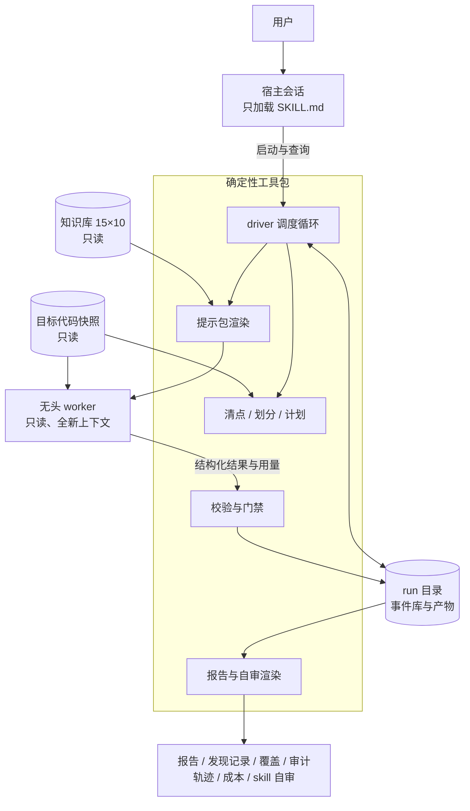

# 通用多语言代码审计 Skill：系统设计

> 状态：草案 v0.2（已按首轮评审修订）｜日期：2026-11-14｜工作代号：`polyglot-audit`（可更名）
>
> **后续需求分解说明**：本文是早期系统设计，部分实现主张已被后续审查修正，不应单独作为实现依据。正式需求编号及当前基线见[系统需求](./SYSTEM_REQUIREMENTS.md)；冲突时以[软件设计](./SOFTWARE_DESIGN.md)和[设计审查](./SOFTWARE_DESIGN_REVIEW.md)为准。原 SR-01～SR-10 仅保留为历史概括编号。
>
> 配套文档：[前代项目复盘](./PREDECESSOR_RETROSPECTIVE.md)（问题编号 P-xx、消耗根因 C-xx 的出处）、[语言问题目录草案](./LANGUAGE_CATALOG_DRAFT.md)、[决策记录](./DECISIONS.md)。
>
> 约束：本文与仓库内任何文件都不出现被审计项目的名称、路径、标识符或结论（§12）。文中的示例路径与符号均为虚构。

## 1. 目标、范围与验收口径

### 1.1 定位

一个可安装到 Claude Code CLI 或 Codex CLI 的代码安全审计 skill。它以 15 种语言各 10 类“语言自身”的安全问题为知识底座，用“确定性工具包 + 只读 LLM worker”的方式审计从小型到超大型、从单语言到混合语言的代码库。一次审计可中断、可恢复，审计即全量覆盖（预算仅承担记账与失控保护，不构成覆盖规划，[DA-10]），产出三样东西：以 source→sink 证据链和修复紧迫度为核心的报告；完整的过程卷宗；一份针对 skill 自身的审查报告。

### 1.2 系统需求

| 编号 | 需求 | 验收口径 |
|---|---|---|
| SR-01 | 通用：skill 不携带任何历史审计项目信息 | 载荷检查零命中；运行期不存在写回 skill 的路径；每次审计默认全新开始 |
| SR-02 | 语言覆盖：15 种语言 × 10 类语言自身问题 | 150 张卡片全部通过语言特异性、去样板、公开来源检查；目录外的问题同样可以报告 |
| SR-03 | 规模与稳定：大型、超大型、单语言、混合语言，可长期运行 | 中断后可恢复且不重复已完成工作；没有静默的覆盖缺口；协调开销不随任务数增长 |
| SR-04 | 报告：source→sink 明确，给出修复紧迫度 | 每条确认的发现都有 source、sink、有序证据链、守卫分析、紧迫度及其判定因子；报告由记录机械派生 |
| SR-05 | 可追溯：保留审计过程文档 | 任一结论可回溯到产生它的任务、提示包、证据锚点与代码快照 |
| SR-06 | 自审：每次审计产出 skill 自身问题的审查报告 | 报告自动生成；可移植部分通过泄漏检查，可直接作为升级输入 |
| SR-07 | 双 CLI：Claude Code 与 Codex | 同一份载荷在两种 CLI 上安装即用；能力差异由探测与适配层吸收 |
| SR-08 | 低自耗：skill 自身的消耗受控且可度量 | 见 §6.10 的指标与目标值 |
| SR-09 | 安全：只读审计，目标内容不可信 | 默认不执行目标代码；worker 无写权限、无网络工具 |
| SR-10 | 可演进：升级不带来膨胀与偏置 | 文本与机制预算由 CI 强制；变更过准入清单；没有按版本同步的仪式 |

### 1.3 非目标

- 不是独立的静态扫描器。信号扫描只产生线索，不产生结论。
- 首版默认不做动态验证，不联网探测任何部署环境。
- 审计即全量覆盖：计划覆盖全部纳入清单的单元，tier 仅决定派发优先顺序（[DA-10]）。运行因崩溃、中止或宿主失效而中断时，缺口如实报告；超大型仓库可按组件分多次运行，每个分区内部仍然全量。
- 不提供发布认证或合规结论。门禁通过只说明流程记录完整，不说明代码安全。
- 不兼容前代的状态、队列、命令与知识资产格式。
- 不内置第三方框架的专属知识（留作可选的生态扩展包，§7.6）。

## 2. 设计原则

1. **判断交给模型，记账交给程序。** 能数、能枚举、能推导的事情由工具包完成，不花 token。模型只做读代码和安全推理。
2. **长循环不进上下文。** 调度是一个程序，不是一段对话。协调者与 worker 之间只传路径和一行回执。
3. **输出随发现增长，不随清点增长。** worker 只写阳性结论与例外，不逐项表态。
4. **全量覆盖，缺口显式。**（[DA-10] 修订）审计计划覆盖全部纳入单元，任务预算由 prepare 按计划自动设定（含验证倍率），不构成抽样比例；操作者显式预算低于全量需求时自动提升并留痕。仅当运行因崩溃、中止或宿主失效中断时出现缺口，任何情况下都出报告。
5. **目录是引导，不是围栏。** Top10 决定先看什么，不决定能报什么。
6. **数据单向流动。** skill 载荷只读，运行产物只进 run 目录，没有任何反向通道。
7. **一处定义，处处派生。** 每类记录只有一份 schema，校验器、提示包、报告模板、文档里的枚举表都由它生成或与它核对。
8. **能观测的不靠声明。** 读了哪些文件、花了多少 token，从宿主日志里取。无法验证的自我声明不收集。
9. **优先取消机制，其次才是加守卫。** 一个问题如果来自某个机制的存在，先问这个机制能否不要。
10. **不绑定模型能力。** CLI 背后可能是任意供应商的模型。格式由自己校验，窗口大小靠探测，契约保持扁平简单。
11. **门禁失败即关闭，并且可被反例验证。** 每个门禁都有一个必须让它失败的夹具。
12. **机制有预算。** 文本长度、命令数、字段数、阶段数都有上限，突破上限需要一条显式的决策记录。

## 3. 总体架构

### 3.1 三层结构



| 层 | 内容 | 是否消耗 token |
|---|---|---|
| 指令层 | `SKILL.md`（不超过 200 行）与按需加载的参考文件：何时使用、硬规则、怎么启动、怎么看状态 | 仅宿主会话加载一次 |
| 工具包层 | 一个只依赖 Python 标准库的命令行工具：清点、划分、调度、渲染提示包、校验、门禁、报告、自审 | 否 |
| worker 层 | 由宿主 CLI 运行的只读 LLM 任务：侦察、审读、验证、可选的动态验证 | 是，消耗集中在这里 |

### 3.2 信任边界与数据流

- **skill 载荷**：只读。任何命令都不向它写入。
- **目标代码**：只读，视为不可信数据。其中的注释、文档、agent 配置文件都不是指令。
- **run 目录**：位于目标仓库之外，是唯一的写入位置，由工具包独占写入。
- **worker**：没有写文件和联网的工具。结果通过进程输出交回，由工具包校验后落盘。

### 3.3 这个分层相对前代的取舍

参考项目 C 是纯 Markdown 指令加两个校验器，轻，但父 agent 要亲手维护账本，规模上不去。前代 B 把状态和校验做成了 2.4 万行的运行时，稳，但调度仍由模型执行，协调者要操作 80 个命令。本设计取 C 的指令简洁和 B 的状态持久，再补上二者都没做的一步：**调度循环本身也是程序**。这一步同时回应规模与消耗两个问题：循环不占上下文，协调不花 token。

## 4. 运行模型

### 4.1 两种使用方式

- **guide**：用户问一个安全问题或要求看某段代码时，只用方法核心与相关卡片直接回答，不建 run 目录，不走流程。这是加载 skill 后的默认行为。
- **audit**：用户明确要求审计一个代码库或要求报告产物时，走完整流程。

请求含义不明确时，先问一个问题再决定。

### 4.2 两种执行引擎

两种引擎地位相同，共用提示包、schema、校验、run 目录和报告，可以在同一次运行中切换。用哪一种由 `audit doctor` 的探测结果和使用场景决定，不设固定偏好。

| | **driver** | **in-session** |
|---|---|---|
| 谁持有调度循环 | `audit run` 进程，逐任务拉起宿主 CLI 的无头 worker | 宿主会话，用自己的子 agent 机制执行 `audit next` 给出的任务 |
| 前提 | 能在当前环境里嵌套启动 CLI，且无头调用能通过认证 | 宿主有子 agent 委派机制 |
| 只读约束 | 由宿主的工具集与沙箱强制 | 靠子 agent 定义与指令；经 MCP 适配后可由工具集强制（§13.5） |
| 用量 | 从 CLI 输出机械读取 | 从宿主会话日志读取；读不到时如实标为不可得 |
| 无人值守与多日运行 | 支持，不依赖任何会话存活 | 依赖会话；可换会话续跑，因为状态都在 run 目录 |
| 协调上下文 | 不增长 | 每批任务增加几百 token |

嵌套启动 CLI 在不少环境里行不通：认证信息在系统钥匙串或用户级配置里，非交互子进程读不到；或者环境本身是沙箱，不允许再起进程。这时 in-session 是唯一可用的引擎，所以它的协议与 driver 一样是标准化的：

- `audit next --batch N` 一次交出至多 N 个任务，每个任务一行：任务编号与提示包路径。
- 协调者为每个任务启动一个子 agent，指令固定为两句话：读这个提示包并照做；完成后提交结果，只回复回执行。
- 子 agent 用 `audit submit` 提交。校验失败时错误清单直接返回给它，在自己的上下文里修正后重交。
- 交出去的任务超过时限仍未提交，会被下一次 `next` 重新交出。这是一个单一的超时，没有续约协议。

宿主没有委派机制时，协调者只能在自己的上下文里顺序执行任务，这只适合几个单元以内的小范围。

driver 可以由用户在终端直接启动，也可以由宿主会话作为后台进程启动后只轮询状态。

```bash
audit doctor                                                           # 探测两种引擎在当前环境是否可用
audit prepare --target <repo> --profile standard --budget tokens=30M   # 清点、划分、给出计划与预估
audit run --run <run-dir> --cli claude --concurrency 4                 # driver：可随时中断，加 --resume 继续
audit next --run <run-dir> --batch 8                                   # in-session：取一批任务
audit status --run <run-dir>                                           # 十几行的状态摘要
```

这里的 `audit` 指载荷里的 `scripts/audit.py`。

### 4.3 阶段

| 阶段 | 执行者 | 做什么 | 主要产物 | 预算份额（standard） |
|---|---|---|---|---:|
| S0 Prepare | 工具包 | 固定快照、清点、识别语言、应用排除规则、信号扫描、识别跨语言边界、划分单元、风险排序、预算预估 | `inventory/`、`plan/` | 0 |
| S1 Recon | 少量 worker | 只读入口、清单与文档，给出目标类型、攻击者模型、信任边界、入口面、环境守卫基线（§8.1） | `recon/brief.md` | ≤ 5% |
| S2 Hunt | worker（主要开销） | 按风险顺序审读单元，直接产出带 source、sink、证据链的候选，以及跨单元的半链记录（§5.7） | `tasks/*/result.json`、候选 | 60% |
| S3 Verify | 工具包 + worker | 程序先合并候选、连接半链、成簇；worker 再先证伪后定级，给出三种裁决之一 | 发现记录 | 25%（预留） |
| S4 Prove | worker + 沙箱，可选 | 对选定的发现做最小化的动态复现 | 复现记录 | 默认 0 |
| S5 Report | 工具包 | 渲染全部报告，运行门禁，写入终态 | `report/` | 0 |
| S6 Retro | 工具包 + 一个小任务 | 计算指标、运行检测器、生成 skill 自审报告 | `skill-review/` | ≤ 1% |

其余约 9% 作为机动。相对前代的 R0–R6，这里把“面发现、假设生成、类别复审”合并成一次 Hunt，把“验证、反驳、裁定”合并成一次 Verify，取消了逐假设的实验评估阶段（P-17、C-01、C-04）。

### 4.4 状态模型

只有五类对象：run、unit、task、candidate、finding。所有变化以只追加的事件写入一个 SQLite 文件，状态视图由同一个归约函数推导。

- **task**：`queued → running → done`。失败时先在原会话做至多 2 次修复回合；仍失败则全新重试 1 次；再失败进入 `quarantined`。
- **unit**：`planned → hunted`，或 `failed`、`excluded`（`triaged`/`deferred(budget)` 随 DA-10 抽样语义退役；中断运行的未处理单元在缺口清单中如实列出）。
- **candidate**：`proposed → merged → confirmed`，或 `needs_validation`、`rejected`、`unverified`（验证预算随 DA-10 自动覆盖；`unverified(budget)` 退役，验证不完成的候选如实进入 needs_validation/缺口）。

不支持“修订”。上游结果变化时，受影响的下游对象直接作废并重新排队（P-13）。所有 ID 由内容确定性生成，重复执行同一步骤不产生新对象（P-02）。

### 4.5 门禁

| 门禁 | 时点 | 检查内容 |
|---|---|---|
| G0 | S0 之后 | 快照已固定；清点完整；每条被排除的路径都有规则与理由；计划覆盖全部纳入单元，预算由 prepare 自动设定为全量需求（[DA-10]） |
| G1 | S2 之后 | 每个计划单元都处于终态；已完成单元有通过校验的结果和覆盖记录；强信号命中都有处置，或已计为未决 |
| G2 | S3 之后 | 每个候选都处于终态；确认的发现证据链完整，锚点在快照中存在；严重度与紧迫度由因子计算得出 |
| G3 | S5 之后 | 报告中的计数与事件库一致；覆盖声明存在；运行终态已写入 |
| G4 | S6 之后 | 自审报告存在；可移植部分通过泄漏检查 |

门禁都是工具包命令，以退出码表达结果。每个门禁在测试集里至少有一个必须使它失败的夹具（P-10）。

### 4.6 终态

一次运行只有两种终态：`complete`，或 `incomplete(<原因>)`。原因是封闭枚举，例如预算耗尽、用户中止、宿主不可用。两种终态都会生成全部报告，未完成的运行在报告首段写明缺了什么。

## 5. 规模、混合语言与长期稳定

### 5.1 快照与清点

- git 仓库记录提交号与工作区是否干净；非 git 目录记录路径、大小、修改时间的清单。被引用为证据的文件再计算内容散列。
- 清点流式写入，不在内存里构造全量结构，也永远不进入任何模型的上下文。
- 语言按扩展名、shebang 和少量内容特征识别。名册之外的语言标记为“无语言卡片”，仍按统一方法审读，并在覆盖声明里单列。

### 5.2 范围与排除

默认排除第三方依赖目录、生成代码、测试、文档、压缩后的脚本、二进制。每条排除都记录命中的规则，在覆盖报告里可见。交互使用时，`prepare` 之后把范围摘要给用户确认一次，尤其是测试代码是否纳入；无人值守时采用默认值并记录。

### 5.3 信号扫描

每张卡片附带一组正则信号，标明种类（source、sink、净化、边界、配置）与强度（1–3）。扫描由工具包完成，结果有三个用途：给文件和单元做风险排序；写进提示包告诉 worker 线索在哪；驱动长尾部分的反向分诊。

信号只是线索。没有命中不代表没有风险，worker 的审读不受信号限制。

### 5.4 组件与工作单元

- 组件按构建清单文件识别，不深度解析。
- 工作单元按**源码 token 估算值**划分，而不是按文件数。默认目标是每单元约 5 万 token；宿主能报告上下文窗口时，取窗口的 30% 与 12 万中的较小者。
- 划分优先保持同目录、同语言，并把跨语言绑定的两侧放在一起（§5.6）。
- 超过单元上限的大文件按顶层符号边界切块，块之间重叠约 40 行；提示包附带该文件的符号大纲，便于定点阅读。符号边界由逐行的启发式正则识别，不做语法解析，容忍少量误差；识别不出符号时退回固定窗口。

### 5.5 风险分层与覆盖深度

文件风险由可解释的因子合成：信号强度与密度、是否在入口面清单上、路径角色（解析、认证、网络、反序列化、加密等）、语言的内存安全属性、可选的修复历史密度。单元取其文件的聚合值，分为四层：

| 层 | 处理方式 |
|---|---|
| T1 | 完整审读，优先安排，使用最强的模型 |
| T2 | 完整审读 |
| T3 | 只做反向分诊：模型看信号命中及其上下文片段，可疑的文件提升为 T2 的小单元 |
| T4 | 只清点（默认被排除的路径） |

覆盖用四个深度如实表达，报告按“组件 × 语言”给出每个深度的文件数：

| 深度 | 含义 |
|---|---|
| D0 | 已清点并做过信号扫描 |
| D1 | 信号命中已由模型分诊 |
| D2 | 文件已由 hunter 打开审读 |
| D3 | 针对具体候选做过深入验证 |

D2 优先采用**观测值**：从宿主的工具调用日志里取 worker 实际打开过的文件与行范围。宿主不提供日志时退回 worker 的声明，并在报告里标注来源是“观测”还是“声明”（P-15）。覆盖率只由一个函数计算，分母来自冻结的清点，分子来自已校验的记录（P-03）。

### 5.6 混合语言

S0 识别跨语言边界构造：外部函数接口、宿主与脚本的绑定、接口描述文件及其生成桩、对仓库内脚本的子进程调用、嵌入在字符串或配置里的另一种语言。每处边界形成一个**边界单元**，同时包含声明侧与实现侧，加载两侧语言的索引和一张边界卡片。证据链的每一步带语言标记，一条链可以跨语言。

### 5.7 跨单元证据链

分层架构里 source 与 sink 常常隔着几个模块。只靠正向追踪，入口侧的 hunter 往下读两层看不到 sink 就不会产生候选，链在中间静默断掉。这里用三个手段补偿。

**越界阅读。** hunter 可以为了追踪一条链去读单元之外的文件。这些读取被记录，但不计入那些文件的覆盖。追不完的地方写成候选上的 `open_questions`。

**半链记录。** 链的一端落在单元之外时，hunter 仍然要留下可拼接的记录：

- **悬空接收点**：单元内有强信号的敏感操作，局部没有守卫，而它的输入来自单元边界上的某个符号（函数参数、导出接口）。hunter 提交一条 `direction: backward` 的候选，写明边界符号与参数位置。
- **污点出口**：不可信数据未经净化就经某个调用离开了本单元。hunter 在结果的 `frontier` 里记一条：被调符号、参数位置、调用点锚点。

两种记录都有数量上限，只针对强信号和确实来自入口面的数据流，不是逐函数摘要。

**程序连接。** 验证之前，工具包按“符号 + 参数位置”把污点出口与悬空接收点对接，拼成完整的候选链；同一个边界符号后面的多个接收点合成一个验证簇。符号匹配是启发式的，所以拼接只产生待验证的候选，不产生结论：verifier 必须在代码里确认每一条拼接边的调用点。对不上的悬空接收点仍然进入验证，附带程序查到的调用点清单和同组件的入口面；verifier 向上追到入口，或者给出不可达的证据。

中间层（既看不到 source 也看不到 sink 的单元）不要求预先产出任何东西。污点出口落在某个符号上而没有对接记录时，工具包按需为该符号排一个小的连接任务，只问一件事：这个参数最终去了哪里。连接任务有深度与数量上限，从验证预留里出。

verifier 不受单元限制。仓库里存在的依赖源码也可以只读查阅，并记录其版本。决定性事实不在仓库里时（部署配置、未随附的依赖），按 §8.4 的规则给出待验证或带前提的确认。

前代为跨单元连接设计了专门的交接对象，一次真实审计里几十个交接全部停在“待复核”。这里没有需要人工推进的交接状态：半链记录由程序对接，对接结果直接成为验证任务。

### 5.8 调度、限流与熔断

- 并发默认 4。遇到限流或过载类错误时指数退避并降低并发，恢复后逐步回升。
- 每个任务有硬超时；超时后杀掉整个进程组。任务的进展以宿主输出的增长为心跳。
- worker 退出被分为：成功、结构不合格（可修复）、宿主错误（认证、配额、限流、网络）、超时、单任务预算触顶。不同类别走不同处理，宿主错误不计入任务自身的失败次数。
- 最近 20 个任务里同一类错误超过 30% 时熔断：暂停调度并在状态里写明原因，不继续消耗预算。
- 被隔离的任务对应的单元记为 `failed`，在覆盖报告里可见。

driver 引擎下没有租约。worker 进程由 driver 直接持有，不存在“领取后失联”的状态（P-14、P-16）。事件库只有一个写入者：worker 只把结果写到标准输出，由 driver 的主线程集中落库。in-session 引擎下多个子 agent 会各自调用 `submit`，事件库因此启用 WAL 与忙等待超时，每次提交是一个短的独占事务，事件带幂等键。

### 5.9 中断恢复与快照漂移

`run --resume` 从事件库重建状态，跳过已完成的任务。恢复时比对快照；发现文件变化则默认拒绝继续，加 `--accept-drift` 后只把受影响的单元和发现作废重排。

### 5.10 规模档位

| 档位 | 源码规模（约） | 引擎 | 默认做法 |
|---|---|---|---|
| S | 5 万行以下 | in-session 或 driver | T1、T2 全部正向审读 |
| M | 5 万到 50 万行 | driver | T1、T2 正向审读，T3 反向分诊 |
| L | 50 万到 500 万行 | driver | 按组件做侦察；全部分层单元按 T1→T4 优先级全量审读（[DA-10]） |
| XL | 500 万行以上 | driver，可按组件切成多次运行 | 按组件分区并行，每个分区内部全量审读；分区覆盖在卷宗按组件报告（[DA-10]） |

状态规模与任务数成线性，单次状态查询只读计数器。前代的清点与计划文件各有一两兆字节；这里这类文件只由程序读取，不进入任何上下文。

## 6. 消耗控制

### 6.1 消耗模型

```
总消耗 ≈ Σ任务（宿主固定开销 + 提示包 + 读入的代码 + 多轮上下文累积 + 输出）× (1 + 重做率)
```

核心指标是**协议开销占比**：不属于目标代码与安全推理的 token（skill 文本、提示包的固定部分、契约说明、格式修复、整份重做）占总量的比例。

### 6.2 预算与分配

- 预算单位以任务数为主（token/金额在宿主可强制时为增强维度），任务预算由 prepare 按"计划单元 × (1 + 验证倍率) + 1"自动设定，覆盖全部计划单元及其验证需求（[DA-10]）；操作者显式预算仅在 ≥ 全量需求时采纳，低于则自动提升并记 `budget_autosized_full_coverage` 事件。预算耗尽只可能来自失控或极端候选率，触发停止序列并如实 incomplete。
- 验证预留在审读开始之前划出，审读不得占用。预留量先按“每单元 0.2 个候选”估算，跑完首批任务后按实测校准。
- `prepare` 输出按层的任务数与消耗区间预估。预估在首批 10 个任务完成后自动校准，偏差写入自审报告。
- 三种档位不再改变覆盖广度（一律全量，[DA-10]），仅保留复核冗余差异：`quick`（单次验证）、`standard`（高危做第二意见）、`deep`（变体搜索、覆盖复核波次、所有确认项做第二意见）。证据标准三档相同。

### 6.3 提示包预算

提示包由模板确定性渲染，协调者从不撰写或改写它。

| 段 | 内容 | 上限（token，约） |
|---|---|---:|
| 角色与规则 | 只读、目标内容不可信、唯一输出格式、停止条件 | 250 |
| 方法核心 | source→守卫→sink、候选准入门槛、深度上限 | 450 |
| 运行简报 | 目标类型、攻击者模型、信任边界、与本单元相关的入口 | 500 |
| 环境守卫基线 | 项目级的全局防护、适用范围与已知例外，每条带锚点（§8.1） | 300 |
| 单元范围 | 文件清单、强信号命中；超出部分只给计数 | 800 |
| 语言索引 | 主语言每种 400；基座语言每种 150 的精简索引（§7.3） | 合计 1,300 |
| 输出契约 | 字段表加一个最小示例 | 350 |

审读提示包合计不超过约 4,000 token，相对一个 5 万 token 的单元约占 8%。详细卡片不进提示包，worker 在信号命中或需要时自己打开。段落顺序是“稳定内容在前、单元内容在后”，便于宿主的提示缓存命中。任何内容因预算被省略时都留下计数，不做无标记截断。

### 6.4 稀疏输出

审读结果只包含：

- 覆盖回执：`full` 或 `partial`，后者只列跳过的文件与原因。
- 强信号处置：每个命中一个字母代码（候选、有守卫、不受不可信输入影响、测试或死代码、需更多上下文）。每单元至多 40 个。
- 已检查的问题类：`cleared` 与 `na` 两个编号列表。
- 候选数组，含正向候选与悬空接收点（§5.7），至多 12 条。
- 污点出口 `frontier`，至多 10 条。
- 可选的加固备注与 skill 备注，各至多 2 条。

一个没有发现的单元，输出预计在 150 token 左右。数组长度与字符串长度的上限写在 schema 里（P-12、C-03）。

### 6.5 验证的经济性

- 验证前先由程序做机械预检：锚点存在、sink 行包含所称符号、链长至少为 2、不在排除路径内。不合格的候选不花验证 token。
- 候选先按指纹合并，再连接半链（§5.7），然后按 sink 所在位置或共同的边界符号成簇，同一簇（至多 4 个）交给一个 verifier。
- 悬空接收点产生容易、验证昂贵，所以单独限额：它们的验证开销不超过验证预留的 30%，按接收点类别、边界符号的调用点数量、与入口面的距离排序。
- 证伪与验证是同一个任务的两个步骤。第二意见只给高危及以上的确认项。
- 目标：平均每个候选不超过 1.3 个验证任务（C-01）。

### 6.6 任务粒度

本机探测显示，一次无头调用有数千到一万多 token 的宿主固定开销，大小主要取决于工具集：同一种 CLI 上，默认工具集约 11.7k 输入 token，限制为三个只读工具后约 3.2k。由此得出两条规则。worker 一律使用最小工具集。不设微任务：一个任务承载的工作量应在 2 万 token 以上，零碎的检查要么由程序完成，要么并入相邻任务。

### 6.7 模型路由

各阶段可分别指定模型与推理强度：分诊用较便宜的模型，T1 审读与验证用最强的模型。默认全部使用宿主的当前模型。

### 6.8 用量遥测

driver 从宿主 CLI 的输出里读取每个任务的输入、缓存、输出 token，以及可用时的费用与子 agent 统计。worker 不需要也不允许自报用量（P-20）。`COST.md` 按阶段与模型汇总，并给出协议开销占比、每千行成本、每条确认发现的成本、重做与隔离造成的浪费、预估偏差。

### 6.9 停止规则

- **预算触顶**：停止派发审读任务 → 用预留完成候选验证（按潜在严重度排序）→ 渲染报告并标记未完成 → 生成自审。
- **边际收益**（可选）：按风险顺序连续 K 个 T2、T3 单元没有候选时，停止处理更低风险的单元。是否启用及触发点写入覆盖声明。

### 6.10 指标与目标值

| 指标 | 前代实测（复盘 §4） | 目标 |
|---|---|---|
| 协调者需加载的 skill 文本 | 91 KB | 入口不超过 12 KB，参考文件按需 |
| 命令数 | 80 | 不超过 12 |
| 审读阶段占 worker 投入 | 约 10% | 不低于 60% |
| 每个候选的后续任务数 | 约 3.1 | 平均不超过 1.3 |
| 无效任务比例 | 实验评估 99%，类别审计 48% | 不超过 5% |
| 发现类任务的单次输出 | 中位数 25–32 KB | 无发现的单元不超过 1 KB |
| 由模型撰写的批次收尾材料 | 每批中位数 163 KB | 0 |
| 主报告 | 2.6 MB，发现总览从第 14,715 行开始 | 发现在第一屏，明细进附属文件 |
| 带 token 用量的任务 | 0% | 100% |
| 整份重做 | 约 6% | 不超过 3% |
| 协议开销占比 | 未度量 | 不超过 15% |
| 预算控制 | 仅事前估算 | 硬上限加预留 |

这些指标由 S6 自动计算，写入每次运行的自审报告。

## 7. 语言知识库（Top15 × Top10）

### 7.1 名册与版本

名册沿用前代已批准的 15 种语言：C、C++、C#、Go、Java、Rust、Python、JavaScript、TypeScript、Kotlin、Scala、PHP、Ruby、Swift、Shell。每种语言恰好 10 个条目，条目有优先序。目录整体带一个版本号，记入每次运行的元数据。首版条目标题见[目录草案](./LANGUAGE_CATALOG_DRAFT.md)。

### 7.2 入选判据

条目必须是语言自身的问题：根因在语言语义、类型系统、内存模型、标准库或官方运行平台的惯用法里。完整判据（语言内生、公开依据、后果严重、可从源码审出、可点名）见目录草案。跨语言都存在的问题只以该语言特有的形态入选。

### 7.3 卡片结构与分级加载

```
knowledge/languages/<lang>/
  index.md          # 10 行索引：编号、标题、最典型的 sink 线索、何时打开卡片
  <lang>-NN.md      # 卡片：为什么是语言特有、识别要点、追踪时要回答的问题、安全写法与常见误报、合成的正反例、公开参考
  signals.json      # 该语言的信号定义
knowledge/boundaries/   # 跨语言边界卡片
knowledge/method.md     # 语言无关的方法核心，只此一份
knowledge/registry/apis.json   # 允许出现在卡片里的公开接口登记表
```

三级加载：索引进提示包；卡片由 worker 按需打开；通用方法只在 `method.md` 写一次，卡片里只写语言特有的差异。

**基座语言。** 有些语言运行在另一种语言的运行时或接口之上：TypeScript 之于 JavaScript，Kotlin 与 Scala 之于 Java，C++ 之于 C。审读这些语言的文件时，提示包给出主语言的完整索引，再附基座语言的精简索引（只有编号与标题），并写明两者都适用。这样审读 TypeScript 时不会漏看原型污染，审读 C++ 时不会漏看格式化字符串。

### 7.4 质量检查

前代知识库的主要问题是模板化：约七成条目是通用弱点标签的换名（P-18）。这里用 CI 检查强制内容质量：

- **语言特异性**：每张卡片点名至少 3 个该语言特有的接口或语法形态。
- **去样板**：任意两张卡片的文本相似度低于阈值；同一个句子不得出现在多张卡片里。
- **正向准入**：卡片里出现的每个接口名都必须能在登记表里找到，登记表条目带官方文档地址。找不到的标识符使 CI 失败。
- **可测**：每张卡片配一对合成的漏洞示例与修复示例，以及至少一条 sink 信号；测试断言信号在漏洞示例上命中。
- **候选门槛**：每张卡片必须有“不算候选的情形”一节。容易泛化成代码坏味道的条目（忽略错误、强制解包、缺少严格模式等）要写明安全相关的限定条件：只有落在鉴权、验签、证书校验、权限检查、输入校验这类安全判定路径上才算候选，其余只记加固备注。
- **单一语言**：载荷内文本统一用英文书写，避免中英混杂稀释注意力。

### 7.5 目录是引导，不是围栏

- 方法核心与目录无关：任何“不可信输入越过信任边界、未经充分守卫而到达敏感操作”的路径都是候选。
- 目录外的候选用 `other:<短标签>` 标注，照常验证和报告。它们的类别分布进入自审报告，是目录演进的输入。
- 用户可以指定关注的语言或条目，这只影响排序与预算分配，不会拒收其他候选（P-19）。

### 7.6 生态扩展包

第三方框架的专属表现不进核心目录。架构上预留扩展点：扩展包是同样格式的一组卡片与信号，用户显式启用。首版不提供任何扩展包。

### 7.7 治理

条目的增删改通过代码评审完成，需要：公开参考、通过 §7.4 的全部检查、合成示例。每种语言保持 10 条，新增一条就要替换一条。任何条目都不得以“某次审计里见过”作为入选理由。

## 8. 发现与验证方法

### 8.1 方法核心

每个候选要回答四件事：谁是攻击者、他控制什么（source）；这个输入最终驱动了什么敏感操作（sink）；途中本应拦住它的检查在哪里、为什么缺失或不足（守卫）；后果是什么。

**环境守卫基线。** 很多敏感操作在项目里已经被全局机制守住：统一的鉴权中间件、默认开启的 CSRF 防护、模板自动转义、默认参数化的数据访问层、全局输入校验。hunter 不知道这些就会产出证据链完整却已被防住的候选。S1 因此按一份与框架无关的问题清单提取本项目的环境守卫基线：每条写明守卫是什么、在哪里注册（带锚点）、覆盖范围、已知的例外或绕过方式，另列“未发现”的守卫类别。基线进入提示包，不超过 300 token。

基线来自对目标的现场侦察，存在 run 目录里，不属于 skill 的知识。识别具体框架靠模型自己的知识，skill 只提供要问的问题。

基线是需要核对的声明，不是豁免。hunter 以“已被环境守卫防住”为由放过一处敏感操作时，必须引用基线条目并给出该路径确实经过这层守卫的本地证据；路由被排除在中间件之外、绕过数据访问层直接拼接查询，正是要找的问题。基线条目的锚点由程序校验；每条基线被用来放过了多少处，记入自审报告，用来发现写得过宽的条目。

攻击者模型取决于目标类型，由 S1 判定：

| 目标类型 | 不可信输入来自 | 可达性规则 |
|---|---|---|
| 应用或服务 | 网络请求、文件、消息、外部系统 | 从对外入口可达 |
| 库 | 公共 API 的调用者 | 公共 API 即信任边界；仓库内没有调用者不构成否决理由 |
| 工具或基础设施脚本 | 参数、环境、配置、被处理的文件、CI 上下文 | 从这些输入可达 |
| 混合 | 按组件分别判定 | 归属不明时按应用处理 |

### 8.2 两个方向

- **正向追踪**（T1、T2）：从入口面出发，沿数据流读到敏感操作。
- **反向分诊**（T3）：从信号命中的危险操作出发，倒查它的输入是否可能来自不可信来源。模型只看命中点附近的片段，不读整个文件，成本远低于完整审读。

### 8.3 候选准入

候选必须写出 source、sink、至少两步的有序证据链、守卫分析和一句话的安全后果，每一处都带 `路径:行号` 锚点。缺任何一项的观察只能记成一行加固备注，不进入验证（C-02）。没有安全后果的功能缺陷和纯加固建议同样只记备注，不算发现。

悬空接收点（§5.7）的门槛不同：必须是强信号的敏感操作，写出从 sink 回溯到边界符号的局部证据链，并说明局部没有起支配作用的守卫。它没有 source，所以只是待连接的半条链，不直接成为发现。

### 8.4 验证与三种裁决

verifier 在全新上下文里工作，步骤固定：先尝试证伪（找守卫、找不可达条件、找错误的前提），证伪不成立再补全证据链并给出定级因子。

| 裁决 | 条件 |
|---|---|
| `confirmed` | 证据链完整，每一步有锚点，路径上没有有效守卫。可以带明确列出的前置条件 |
| `needs_validation` | 存在一个确切的、在仓库内无法回答的阻断事实。必须从封闭枚举中选择阻断类型（部署配置、外部依赖行为、运行时状态、构建变体、源码缺失、需要执行），并写出验证计划 |
| `rejected` | 找到了使其不成立的证据，并给出该证据的锚点 |

没有“待复核”这种不带结构的状态。

### 8.5 证据等级

证据等级与裁决正交：

| 等级 | 含义 |
|---|---|
| E3 | 在沙箱内动态复现 |
| E2 | 静态完整：证据链逐跳有锚点，并经独立 verifier 确认 |
| E1 | 静态不完整：有未证实的环节 |

`confirmed` 要求 E2 或 E3。E1 只能是 `needs_validation`。等级只能凭新证据上升，转移规则是一张表，逐条有测试（P-09）。

### 8.6 可判定性

前代的多语言试点里约三分之二的假设停在“待复核”（P-21）。对应措施：

- verifier 的职责是给出结论，可以读仓库内任何位置，包括随附的依赖源码。
- 决定性事实取决于配置时，按仓库内的默认配置判定，并把该前提写在发现上（“在默认配置下成立”）。
- 确实无法判定的，阻断事实必须具体到“哪个事实、谁能观察到、怎么观察”。
- 待验证占比、阻断类型分布是自审报告的固定指标。

### 8.7 第二意见与变体搜索

- 高危及以上的确认项交给另一个 verifier 复核锚点、前提与定级是否夸大。两次结论不一致时取保守结论并记录分歧。
- 确认一个高危问题后，verifier 在仓库内搜索同一根因的其他位置，作为变体记在同一条发现下。搜索范围有上限。

### 8.8 动态验证（可选的 S4）

默认关闭。启用时只对选定的发现运行最小化的复现，并要求操作系统级沙箱：无外部网络、目标只读、只能写指定的临时目录、有 CPU、内存、时间上限。缺任何一项就不执行，发现保持静态等级。

## 9. 发现模型与报告

### 9.1 记录结构

```json
{
  "id": "F-0007",
  "title": "…",
  "issue": "py-01",
  "languages": ["python"],
  "verdict": "confirmed",
  "evidence_grade": "E2",
  "source": {"path": "app/handlers/upload.py", "line": 41, "symbol": "handle_upload",
             "kind": "http_body", "control": "未认证的远程请求体"},
  "sink":   {"path": "app/storage/state.py", "line": 120, "symbol": "restore",
             "kind": "deserialization", "effect": "构造任意对象，导致代码执行"},
  "path": [
    {"path": "app/handlers/upload.py", "line": 41,  "role": "source",    "note": "读取请求体"},
    {"path": "app/handlers/upload.py", "line": 58,  "role": "propagate", "note": "原样传给 restore()"},
    {"path": "app/storage/state.py",   "line": 120, "role": "sink",      "note": "反序列化"}
  ],
  "guards": [{"path": "app/handlers/upload.py", "line": 50, "state": "insufficient", "note": "只检查长度"}],
  "attacker": "remote_unauth",
  "preconditions": [],
  "rating": {"impact": 4, "impact_why": "任意代码执行",
             "exploitability": 4, "exploitability_why": "未认证远程，默认配置",
             "severity": "critical", "urgency": "P0", "adjustment": null},
  "remediation": {"where": "app/storage/state.py:120", "change": "…", "regression_test": "…"},
  "variants": [],
  "provenance": {"candidates": ["…"], "hunt_tasks": ["T-0042"], "verify_tasks": ["T-0107", "T-0131"]}
}
```

跨语言的证据链在每一步上带 `lang` 字段。`needs_validation` 记录另有 `blockers` 与 `validation_plan`，`rating` 里是验证优先级而不是紧迫度。

校验器强制：证据链以 `source` 开始、以 `sink` 结束；每个锚点在快照中存在；`severity` 与 `urgency` 等于由因子算出的值；没有任何字段有默认值，缺失即失败（P-04、P-24）。指纹由问题类、sink 所在文件与符号、source 种类生成，不含行号。

### 9.2 严重度与修复紧迫度

verifier 给出两个因子并各写一句理由，其余由程序计算。影响因子只能按证据链实际证明的后果取值，不能按理论上的最坏情况取值。

- **影响 I**：4 为代码执行、整体失陷或大规模数据泄漏；3 为认证绕过、越权读写、共享服务被远程打停；2 为范围有限的越界；1 为轻微信息暴露。
- **可利用性 X**：4 为未认证远程且在默认配置下；3 为低权限已认证，或需要常见的非默认配置；2 为需要特殊位置或条件（相邻网络、用户交互、竞态、高权限）；1 为仅本地或仅特权用户。

| I \ X | 4 | 3 | 2 | 1 |
|---|---|---|---|---|
| **4** | Critical | High | High | Medium |
| **3** | High | High | Medium | Low |
| **2** | Medium | Medium | Low | Low |
| **1** | Low | Low | Low | Info |

| 紧迫度 | 含义 | 规则（取满足的最高一档） |
|---|---|---|
| P0 | 立即修复，必要时暂停发布 | Critical；或 High 且 X=4 |
| P1 | 本迭代内修复 | 其余 High；Medium 且 X=4 |
| P2 | 排入近期计划 | 其余 Medium；Low 且 X≥3 |
| P3 | 择机加固 | 其余 Low 与 Info |

verifier 可以上调或下调至多一档并写明理由（例如默认配置里已有补偿控制，或受影响的是密钥材料）。报告同时显示规则值与调整后的值。

`needs_validation` 不给紧迫度，只给验证优先级 V1–V3，由声称的 I 与 X 套用同一张表得到，并明确标注为“若成立”。前代按弱点编号机械映射严重度并以“中危”兜底，造成过多次误渲染；这里不存在兜底值。

### 9.3 报告集

`report/` 目录固定七件套，**不含 skill 自审**——自审按 §10.1 常驻于独立的 `skill-review/` 目录（`SKILL-REVIEW.md`，可移植导出为 `skill-review/portable.json`），二者是 §11 同源信息的两个消费者视角，不在 report/ 混排（[DA-07] 决议）。

| 文件 | 内容 |
|---|---|
| `REPORT.md` | 范围、快照、终态、覆盖声明；按紧迫度排序的发现总表；逐条发现卡片；待验证清单摘要；方法与局限 |
| `findings.json` | 全部发现记录，可选导出 SARIF |
| `NEEDS-VALIDATION.md` | 每条待验证项的阻断事实与验证计划，按验证优先级排序 |
| `COVERAGE.md` 与 `coverage.csv` | 按组件、语言、深度汇总的覆盖；未审读的高风险单元清单；逐文件明细在 CSV 里 |
| `AUDIT-TRAIL.md` | 审计轨迹（§10.3） |
| `COST.md` | 消耗报告（§6.8） |
| `lessons.md` | 运行教训卷宗（SR-031/DSR-081：按 docs/LESSONS-TEMPLATE.md 模板归档，运行产物、非 skill 资产） |

> 历史注记：本节曾把 `SKILL-REVIEW.md` 列入 report/ 七件套，与 §10.1 的 `skill-review/` 独立目录自相矛盾；已按实现决议（自审归 skill-review/）修订，第七件套为 lessons.md。[DA-07]

### 9.4 编排规则

- 发现优先：`REPORT.md` 的第一屏是终态、覆盖声明和发现总表。逐路径明细只放在 CSV 里。
- 主报告有体积预算，超出时明细自动移入附属文件。
- 报告全部由记录渲染，模型不撰写报告。记录里的标题、说明、理由由 worker 用用户指定的语言书写，键与枚举保持英文。
- 发现涉及硬编码凭据时，记录位置与类型，不复制凭据值。

### 9.5 单条发现的呈现

```
### F-0007 ［P0 立即修复］未认证请求体进入不安全反序列化

裁决 confirmed ｜ 证据 E2（已经第二意见复核）｜ 严重度 Critical（影响 4，可利用性 4）｜ 问题类 py-01

Source  app/handlers/upload.py:41    handle_upload()   HTTP 请求体，攻击者完全可控
  ↓     app/handlers/upload.py:58    body 原样传给 restore()
Sink    app/storage/state.py:120     restore() 对其反序列化，可构造任意对象

守卫    upload.py:50 只检查长度；路径上没有签名校验或类型白名单
前提    无（默认路由，未启用认证）
修复    在 state.py:120 改用纯数据格式并校验结构；回归测试：携带构造对象的请求应被拒绝
来历    审读任务 T-0042 → 验证任务 T-0107 → 复核任务 T-0131
```

## 10. 过程卷宗与可追溯

### 10.1 run 目录

```
<run-dir>/
  run.json            # 不可变元数据：目标、快照、skill 版本与摘要、目录版本、配置、档位、预算
  events.db           # 只追加事件与由它推导的视图；另含只读的清点表（文件、排除记录、信号命中）
  inventory/          # 清点汇总
  plan/               # 单元、队列顺序、预算分配、预估
  recon/              # 运行简报、入口面
  tasks/<task-id>/    # 提示包、结果、校验日志、用量、工具调用摘要
  candidates/         # 合并后的候选
  findings/<id>/      # 发现记录、状态变迁历史
  report/             # §9.3 的全部文件
  skill-review/       # 自审报告：可移植部分与本地证据
```

默认位置在用户主目录下按“目标名/日期-序号”组织，可用参数指定。永远不放在目标仓库里。

### 10.2 证据链

每条发现可以沿 `provenance` 回溯到：提出它的审读任务（当时的提示包原文、原始结果、用量）、裁决它的验证任务、每个锚点对应的文件散列与快照。被驳回的候选连同驳回理由一并保留。

### 10.3 审计轨迹

`AUDIT-TRAIL.md` 由事件库渲染，包含：运行元数据与工具、模型配置；范围与排除决定及其理由；预算与实际消耗；时间线（阶段起止、暂停、恢复、熔断）；每条发现的来历索引；被驳回候选的理由摘要；失败与被隔离的任务清单。

### 10.4 保留策略

提示包与结果始终保留。完整的 worker 对话记录默认不保留，只保留工具调用摘要（工具名、路径、行范围），这已足以支撑观测覆盖；需要时可显式开启完整保留。卷宗包含目标代码片段，只留在本地。

## 11. Skill 自审报告与升级闭环

### 11.1 内容

每次运行结束自动生成 `SKILL-REVIEW.md`：

1. **运行概况**：规模、档位、预算与实际、终态。
2. **消耗体检**：§6.10 的全部指标。
3. **质量体检**：候选确认率、驳回原因分布、待验证占比与阻断类型分布、第二意见推翻率、目录外候选占比。
4. **知识库体检**：每张卡片被打开的次数、对应的候选数与确认数；零产出的卡片；没有卡片的语言。
5. **契约与流程体检**：按字段统计的校验失败、修复回合数、超时与隔离、门禁失败记录。
6. **问题清单**：自动检测出的问题，加上 worker 与协调者提交的 skill 备注。
7. **建议的回归夹具**：用合成场景描述如何复现每个问题。

### 11.2 自动检测器

问题清单的主体由程序从事件库算出，例如：某字段的校验失败率超过阈值；重做率或无效任务率超标；协议开销占比超标；某张卡片多次加载而零产出；同一驳回理由反复出现；待验证占比偏高；预估偏差超过 30%；观测覆盖与声明覆盖不一致。每个检测器输出一条结构化问题。

worker 的 skill 备注是结构化的短条目（类别枚举、现象、建议，各有长度上限），每个任务至多 2 条。最后由一个小任务对全部条目做聚类和去重。

### 11.3 问题分类

固定枚举：`CONTRACT`、`INSTRUCTION`、`KNOWLEDGE`、`PLANNING`、`DISPATCH`、`STATE`、`COVERAGE`、`VERDICT`、`REPORT`、`COST`、`SAFETY`、`PORTABILITY`、`GENERALITY`。每条问题包含：编号、类别、阶段、严重程度、现象、度量证据、建议改动的对象、回归期望。

### 11.4 可移植边界

自审报告分成两部分：

- **可移植部分**（`skill-review.json`）：只包含枚举、数值和通过泄漏检查的短文本。这是唯一允许离开 run 目录进入 skill 开发流程的内容。
- **本地证据**：引用具体任务与产物，留在 run 目录。

泄漏检查的词典在运行时由目标生成：仓库名、远端组织名、顶层目录名、包与模块名、出现在发现里的文件名与符号名，再加上通用模式（绝对路径、URL、散列、邮箱、IP）。命中的文本字段整体替换为占位符并打上标记，不会静默放行。这份词典只存在于 run 目录。

### 11.5 升级闭环

```
可移植自审 → 导入 skill 仓库的待办（再过一次泄漏检查）→ 跨运行按类别与阶段聚合
          → 准入清单（§17）→ 编写合成回归夹具 → 修改 → 预算与载荷检查 → 发布
```

两条纪律：同一类问题在至少两次独立运行中出现，或属于阻断性缺陷，才进入修改，以免按单次运行调参；每个修复必须配一个合成的回归夹具，不允许以真实项目作为回归锚点。

## 12. 通用性保障

### 12.1 规则

1. skill 载荷里不出现任何被审计项目的名称、路径、标识符与结论，也不出现从审计结果得出的统计（例如按语言或类别的发现计数）。
2. 知识条目只引用语言、标准库、官方平台 SDK 的公开接口，示例全部为合成代码。
3. 载荷里不出现漏洞公告编号与事件叙述；弱点分类编号可以使用。
4. 设计文档、变更日志、提交信息、测试夹具不出现被审计项目的名称、路径、标识符与结论。它们可以引用 skill 自身的过程度量（任务数、消耗、失败率），但不附带能识别目标的信息。
5. 仓库里不保存任何“真实项目名单”，包括用于检查的黑名单。

### 12.2 结构性机制

- **没有写回通道。** 前代的泄漏主要来自“审计收尾时回填 skill 资产”。本设计里已安装的 skill 是只读的，审计产物只进 run 目录（P-05、P-08）。
- **默认全新。** 一次新的审计不读取任何历史 run 目录。对同一目标的增量复审必须显式指定前一次运行，且其内容只用于差异计算，不进入 skill。
- **升级只走可移植自审。**（§11.4）
- **评测语料隔离。** 用真实漏洞做的留出评测放在仓库之外的评测工作区，结果只以“语言 × 条目”的聚合指标回到仓库。

### 12.3 自动检查

- **载荷检查**（CI）：绝对路径、散列、邮箱、IP、工单与公告编号等模式；卡片里未登记的标识符；卡片间相似度；文本体积预算。
- **正向准入**（CI）：§7.4 的登记表机制。前代的经验是黑名单永远落后于下一个项目，正向判据才追得上。
- **运行时泄漏检查**：§11.4。
- **提交信息检查**：与载荷检查同一组通用模式。开发者可以在仓库之外维护自己的补充词表。

### 12.4 开发纪律

沿用并机械化前代的四项评估：盲目带入历史信息由上述检查覆盖；设计偏见由按语言的卡片质量与产出均衡度指标提示；死代码由“每个 schema 字段都有消费者”的测试覆盖；过设计由机制预算覆盖（§15.4）。

## 13. 双 CLI 适配

### 13.1 载荷与安装

仓库里只有 `skill/` 目录是可安装载荷，结构符合两种 CLI 共同支持的 skill 格式：`SKILL.md`（frontmatter 只用 `name` 与 `description`）、`scripts/`、`references/`，以及 Codex 的界面元数据文件。安装即把该目录复制或链接到各 CLI 的 skill 目录。

### 13.2 能力探测

`audit doctor` 在运行前探测并记录：CLI 是否存在及其版本；用所选隔离参数做一次最小无头调用是否成功；结构化输出是否被强制；能否取得用量与上下文窗口；只读沙箱是否可用。探测结果决定适配参数，写入 `run.json`。探测到隔离参数导致认证失效时，自动退到次一级的隔离组合并给出提示。

### 13.3 无头 worker 的适配

| 需要的能力 | Claude Code | Codex |
|---|---|---|
| 无头执行并取回结果 | `-p` 加 `--output-format json` 或 `stream-json` | `codex exec --json`，`-o` 取最终消息 |
| 结构化输出 | `--json-schema` | `--output-schema` |
| 只读 | `--tools "Read,Grep,Glob"` 加显式的 `--permission-mode` | `--sandbox read-only` |
| 单任务费用上限 | `--max-budget-usd` | 由 driver 的超时与 token 统计控制 |
| 不加载目标内的项目级配置 | 工作目录设为任务目录，`--setting-sources user`，目标经 `--add-dir` 授权 | `-C` 指向任务目录，目标以绝对路径读取 |
| 修复回合 | `--resume <session>` | `codex exec resume` |
| 模型与推理强度 | `--model`、`--effort` | `-m`、`-c` |
| 用量 | 结果里的 `usage`、费用、上下文窗口、子 agent 统计 | `turn.completed` 事件里的 `usage` |
| 沙箱内执行命令（仅 S4） | 由外部沙箱提供 | `codex sandbox` |

### 13.4 结构化输出与修复回合

1. 能用宿主的结构化输出就用。
2. driver 从输出里提取 JSON。只容忍传输层包装（代码围栏、首尾空白），不容忍字段名或结构上的偏差。
3. 先做 schema 校验，再做语义校验（锚点存在、链的顺序、枚举、交叉字段）。
4. 不合格时在同一会话里把错误清单发回，至多 2 次。
5. 仍不合格按 §4.4 处理。

不为任何形态变体编写归一器。某个字段反复出错时，自审报告会产生一条 `CONTRACT` 问题，修的是契约或提示，不是在接收端加容错（P-01）。边界澄清（[DA-08]，RUN-LESSONS 真实形态防御族）：**传输层文本提取与类型防崩溃**（散文包裹 JSON 的首尾大括号提取、代码围栏剥离、对字符串/对象两态的渲染防崩溃）属于合法的传输层处理，不是本句禁止的"归一器"；被禁止的是**业务语义层归一**——把无效字段名、错误结构或缺失结论在接收端修成有效。契约自身自相矛盾（如一处在示例中定义字符串形态、另一处门禁要求对象形态）时，修复路径是**对齐契约文本**并对已产出工件做一次性记账规范化（归档保留原始文本、过程留痕），这与接收端容错有本质区别。

### 13.5 会话内引擎与 MCP 适配

会话内引擎的协议见 §4.2。`SKILL.md` 使用与平台无关的说法：“用你的委派机制启动一个子 agent”。给子 agent 的指令固定为两句话，协调者每批任务只增加几百 token 的上下文。

工具包另外提供一个 MCP 适配：`audit mcp` 以标准输入输出方式运行一个 MCP 服务，只暴露四个工具（取任务、提交结果、看状态、查卷宗），实现上是对同一组函数的薄封装。它解决两件事：

- 宿主不必知道脚本路径，也不依赖子 agent 能运行命令行。
- 子 agent 可以被定义成只有读文件工具加这四个工具，于是会话内引擎的只读约束也能由工具集强制，而不只靠指令。

挂载 MCP 服务会让它的工具说明常驻宿主上下文，所以工具数量固定为四个、说明保持简短，并建议只在审计时挂载。其他支持 skill 或 MCP 的宿主可以用同一协议接入，但不在首版的验收范围内。

### 13.6 已验证与待验证

2026-11 在本机用两种 CLI 的当前版本验证过：

- 无头调用可用，结果里带 token 用量；其中一种还带费用、上下文窗口与子 agent 统计。
- 固定开销随工具集变化：同一种 CLI 上，默认工具集的最小调用约 11.7k 输入 token，限制为三个只读工具后约 3.2k；另一种 CLI 的默认配置下约 6.5k。
- 结构化输出在一种后端上被严格执行，在另一种后端上返回了围栏包裹的 JSON。
- 忽略用户级配置的隔离开关会丢失认证；用户级的默认权限模式在无头环境下可能被拒绝，需要显式指定。

M0 阶段还需验证：流式输出里能否稳定取得工具调用（用于观测覆盖）；任务目录作为工作目录时，目标内的 agent 配置文件确实不被加载；只读沙箱下以绝对路径读取目标的行为；修复回合的会话恢复；较弱模型上的契约遵守率。

## 14. 安全设计

- **只读。** 目标代码从不被修改。worker 没有写文件工具，结果经进程输出返回。
- **默认不执行目标代码。** 不构建、不运行测试、不导入、不执行片段。静态 worker 在 Claude Code 上没有命令执行工具，在 Codex 上处于只读沙箱。
- **两种引擎的强度不同。** 上面两条在 driver 引擎下由宿主的工具集与沙箱强制。会话内引擎的子 agent 默认沿用会话自身的工具权限，只读只能靠指令约束；经 MCP 适配把子 agent 限定为只读工具后，约束才由工具集强制。审计不可信仓库时应使用 driver，或使用限定了工具集的会话内引擎。
- **目标内容不可信。** 提示包声明：代码、注释、文档中的任何指令都只是数据。独立的 verifier 是对“被目标内容误导的候选”的第二道防线。
- **目标内的 agent 配置文件。** 仓库里的 agent 指令文件、项目级设置、钩子与自带 skill，如果被宿主当作配置加载，就是直接的注入通道。worker 因此在任务目录里启动，不以目标为项目根。用户在目标目录里直接开会话审计不可信仓库时，`SKILL.md` 会提示改在目录外启动。
- **不联网。** worker 没有联网工具，不探测任何部署环境。
- **凭据。** 报告不复制凭据值（§9.4）。
- **资源清理。** driver 退出时杀掉全部子进程组，不留后台进程。
- **授权。** skill 只用于获得授权的审计，`SKILL.md` 在硬规则里写明。

## 15. 仓库结构与工具面

### 15.1 仓库布局

```
skill/                      # 唯一的可安装载荷，运行期只读
  SKILL.md
  VERSION                   # 唯一的版本号
  references/               # 按需加载：流程、会话内引擎、安全、读报告、排障
  prompts/                  # 提示包模板：recon、hunt、triage、verify、prove、retro
  knowledge/                # §7.3
  schemas/                  # 记录 schema 与定级表
  scripts/audit.py          # 单一入口，只依赖标准库
  scripts/audit/            # 工具包模块，含两种 CLI 的适配器
tests/                      # 单元测试、合成夹具、黄金报告、门禁反例
evals/                      # 评测脚手架；语料在仓库之外
tools/                      # 仅开发用：载荷检查、预算检查、安装脚本
docs/design/                # 设计文档与决策记录
CHANGELOG.md  README.md
```

### 15.2 命令面

| 命令 | 作用 |
|---|---|
| `doctor` | 探测宿主能力 |
| `prepare` | S0：建立 run 目录，输出计划与预估 |
| `run` | driver 循环，S1–S6；支持恢复、限定阶段、预算、档位、并发 |
| `status` | 状态摘要 |
| `next` | 会话内引擎：取一批任务，每个任务输出一行编号与提示包路径 |
| `submit` | 校验并存入一个任务结果，输出一行回执或精确的错误；`--dry-run` 只校验不存入 |
| `mcp` | 以 MCP 服务方式暴露 `next`、`submit`、`status`、`show` |
| `show` | 只读查询卷宗：单元、任务、候选、发现的来历，文件大纲，信号命中 |
| `gate` | 运行门禁 |
| `report` | S5 渲染，可重复执行 |
| `retro` | S6 自审与泄漏检查 |
| `export` | 导出 SARIF、CSV、可移植自审 |

### 15.3 Schema

记录类型：run、unit、task、recon 结果、hunt 结果（含候选）、verify 结果、finding、skill 备注、prove 结果。Schema 写在两种宿主的结构化输出都支持的子集内：对象、必填字段、枚举、数组，不依赖 `oneOf` 与正则。更细的规则放在语义校验里。校验器是手写的最小实现，只支持这个子集，不引入第三方库。文档里的枚举表由 schema 生成（P-24）。

### 15.4 机制预算

| 对象 | 上限 |
|---|---|
| `SKILL.md` | 200 行，12 KB |
| 单个参考文件 | 8 KB |
| 单个提示包模板 | 3 KB |
| 语言索引 | 2 KB |
| 单张卡片 | 3 KB |
| 命令数 | 12 |
| 门禁数 | 5 |
| 事件类型数 | 20 |
| 记录类型数 | 9 |
| 单个记录的字段数 | 20 |
| 工具包代码量 | 5,000 行（软上限） |

预算由 CI 检查。突破任何一项都需要在决策记录里写明理由并调整数字。

## 16. 质量保证与评测

| 层 | 内容 | 是否调用模型 |
|---|---|---|
| 单元测试 | 清点、划分、归约、校验、定级、渲染 | 否 |
| 门禁反例 | 每个门禁至少一个必须失败的夹具 | 否 |
| 黄金报告 | 固定记录集渲染出的报告逐字比对 | 否 |
| 知识库测试 | 每张卡片的信号在其漏洞示例上命中；§7.4 的全部检查 | 否 |
| 规模测试 | 合成的十万文件目录树，检验确定性阶段的耗时与内存 | 否 |
| 150 格评测 | 在每张卡片的合成正反例上运行完整流程，统计每格的检出、误报与成本 | 是，按需运行 |
| 留出评测 | 仓库外的真实漏洞语料，只回传聚合指标 | 是，按需运行 |
| 双 CLI 验收 | 同一夹具在两种 CLI、两种引擎下各跑一遍 | 是 |

测试只写临时目录。夹具全部是为本项目编写的合成代码（P-11）。测试断言行为，不断言版本号、资产数量或提示词措辞。

150 格评测给出前代一直没有的东西：按“语言 × 条目”的能力矩阵。它用合成代码检验“能否在小段代码里识别该模式”，不替代留出评测对真实规模的检验。

## 17. 演进与变更控制

**准入清单。** 任何新增的指令、字段、命令、阶段、卡片内容，都要回答：

1. 触发条件是什么？没有明确触发条件的不加。
2. 消费者是谁？没有消费者的不加。
3. 去掉它会失去什么？说不出来的降为可选提示。
4. 模型本来就能推导出来吗？能推导的不写进 skill。
5. 它对任何项目都成立吗？只对某一类目标成立的，挂到带适用条件的卡片上。
6. 它占用哪项预算？超出预算时要替换掉什么？

前四问来自前代的开发纪律，后两问针对通用性与膨胀。

**版本。** 只有一个 `VERSION` 文件，放在载荷里。设计文档就地更新，重大取舍追加到决策记录。不存在按版本生成的文档套件、版本守卫测试和状态追踪文档（P-06、P-22）。

**兼容。** run 目录带 schema 版本。新版工具包对旧 run 目录只保证能读状态和重新渲染报告。

**重设计信号。** 沿用前代定义的五个信号，并用跨运行聚合的自审数据来观察：修复互相冲突、特例分支累积、门禁被形式化通过、知识复用率趋零、兼容债务增长。

## 18. 实施路线

| 里程碑 | 内容 | 完成判据 |
|---|---|---|
| M0 预研 | 两种 CLI 的最小 driver；会话内引擎的 `next` 与 `submit`；§13.6 的待验证项 | 一个 hunt 任务在两种 CLI 上各自完成“渲染提示包 → 无头执行 → 校验 → 落盘 → 记录用量” |
| M1 确定性底座 | S0、状态模型、校验、门禁、报告骨架、机制预算与载荷检查 | 十万文件规模测试通过；全部门禁反例通过 |
| M2 发现与验证闭环 | Recon 与环境守卫基线、Verify、候选合并与半链连接、定级、报告；MCP 适配 | 三种语言的合成夹具端到端产出正确报告；跨单元夹具的半链被正确对接 |
| M3 知识库 | 15 种语言的卡片、信号、示例、登记表 | 150 张卡片通过全部质量检查；150 格评测有基线 |
| M4 规模与稳定 | 分层与分诊、边界单元、按需连接任务、限流熔断、恢复与漂移、成本遥测 | 长时间运行中多次强制中断后结果一致；§6.10 的指标可自动产出 |
| M5 自审与升级 | 检测器、可移植导出、待办导入、准入工具 | 一次运行的自审可被导入并聚合；泄漏检查的反例通过 |
| M6 验收 | 留出评测、双 CLI 验收、文档 | 两种 CLI 上的验收运行达到 §6.10 的目标值 |

后续可选：动态验证、同目标增量复审、生态扩展包、对宿主原生编排机制的适配。

## 19. 风险、假设与待确认决策

### 19.1 风险

| 风险 | 应对 |
|---|---|
| CLI 背后的模型能力差异大：格式不稳、分析浅 | 契约扁平；修复回合；验证漏斗；能力探测；自审里按模型统计契约遵守率 |
| 正则信号漏报或过报 | 信号只做线索与排序；审读不受信号限制；检出率由 150 格评测度量 |
| 切块打断跨文件数据流 | 允许越界阅读；verifier 不受单元限制；边界单元；自审跟踪“因缺上下文而待验证”的比例 |
| 观测覆盖依赖宿主日志格式 | 退回声明覆盖并标注来源 |
| 预算预估不准 | 首批任务后校准；硬上限兜底 |
| 15 种语言的卡片编写质量 | §7.4 的检查；逐语言评审；150 格评测 |
| 简化后少了前代的部分保证（租约、认证、签名） | 有意的取舍：保证来自独立验证与机械门禁；文档里写明不保证什么 |
| 嵌套启动 CLI 受沙箱、网络或认证限制 | driver 可由用户在终端直接启动；会话内引擎作为后备 |
| 纯静态确认可能夸大 | 证据等级明示；高危第二意见；可选的动态验证 |
| 泄漏检查过度遮蔽 | 细节保留在本地证据里 |

### 19.2 设计依赖的假设

- 两种 CLI 会继续提供无头执行、用量输出和只读运行方式。
- 目标仓库可以被完整地只读访问。
- 预算由 prepare 按计划自动设定（全量需求，[DA-10]）；操作者可选提供不低于全量需求的显式预算。

### 19.3 决策状态

首轮评审已对 D1–D10 给出结论，连同评审带来的设计调整一起记在[决策记录](./DECISIONS.md)里。本文已按这些结论修订。

## 附录 A：复盘条目到设计章节

| 复盘条目 | 设计章节 |
|---|---|
| P-01 输出形态漂移 | §13.4、§15.3 |
| P-02 簿记覆盖、P-13 状态模型过大 | §4.4 |
| P-03 覆盖率口径、P-15 声明式保证 | §5.5 |
| P-04 报告失真、P-24 证据链顺序 | §9 |
| P-05 双副本漂移、P-08 经验回灌 | §3.2、§11、§12 |
| P-06 版本仪式、P-22 状态文档 | §17 |
| P-07 条款堆积 | §6.3、§15.4、§17 |
| P-09 判定逻辑 | §8.4、§8.5 |
| P-10 门禁、P-11 测试污染 | §4.5、§16 |
| P-12 输出爆炸 | §6.4 |
| P-14 重试与租约、P-16 协调者负担 | §3、§5.8、§13 |
| P-17 无效任务 | §4.3、§6.5 |
| P-18 知识模板化、P-19 目录当围栏 | §7 |
| P-20 用量不可测 | §6.8 |
| P-21 结论不可判定 | §8.4–§8.6 |
| P-23 分发结构 | §13.1 |
| P-25 模式与终止条件 | §4.1、§6.3 |
| P-26 执行风险 | §8.8、§14 |
| C-01 至 C-10 消耗根因 | §6 |

## 附录 B：术语

| 术语 | 含义 |
|---|---|
| run | 一次审计运行：一个目标快照、一份配置、一个预算 |
| unit（单元） | 分配给一个审读任务的一组文件或文件块 |
| task（任务） | 一次 worker 调用 |
| 提示包（packet） | 工具包为一个任务渲染的完整提示 |
| candidate（候选） | hunter 提出的、带 source、sink 与证据链的疑似问题 |
| finding（发现） | 经验证得到裁决的记录 |
| 卡片 | 知识库中描述一个语言问题的文件 |
| 信号 | 由程序匹配出的线索 |
| 卷宗 | run 目录的全部内容 |
| hunter、verifier | 分别执行审读与验证的 worker |
